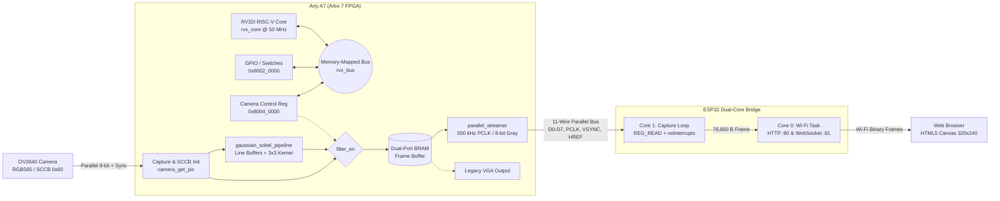

# OV2640 Camera & RVX RISC-V SoC with Hardware Accelerator and Wireless Streaming

An Artix-7 FPGA embedded vision system integrating an **OV2640 camera pipeline** into the custom **RVX RISC-V SoC (`rvx_cam`)**, featuring real-time **Gaussian-Sobel hardware acceleration**, Memory-Mapped I/O (MMIO) control via bare-metal C firmware, and live $320 \times 240$ (QVGA) wireless video streaming to a web browser through an **8-bit parallel FPGA-to-ESP32 bus**.

> **Platform Evolution:** Originally developed for the Digilent Nexys 4 with VGA output, this project has been migrated to the **Digilent Arty A7** with a high-speed parallel wireless bridge to an **ESP32**. The legacy top-level wrapper name (`rvx_cam_nexys.v`) and VGA output ports remain intact in the RTL for backward compatibility.

---

## Hardware Requirements

* **Development Board:** Digilent Arty A7 (Xilinx Artix-7 FPGA) *(originally targeted for Digilent Nexys 4)*
* **Camera Peripheral:** OV2640 Camera Module (configured via SCCB at slave address `0x60`)
* **Wireless Bridge:** ESP32 Development Board (dual-core Wi-Fi HTTP & WebSocket server)
* **Output:** Any modern Web Browser over Wi-Fi *(legacy VGA monitor interface also retained in RTL)*

---

## `rvx_cam` (RISC-V SoC with Sobel Accelerator)

This project integrates the real-time camera and image-processing pipeline into the custom RVX RV32I soft processor, decoupling high-level system control from pixel-rate computation:

* **Hardware Accelerator:** Includes a custom `gaussian_sobel_pipeline` that applies a $3 \times 3$ Gaussian noise filter followed by a Sobel edge-detection filter directly on the live video stream using on-chip line buffers with zero CPU overhead.
* **Memory-Mapped I/O (MMIO):** The camera accelerator is mapped to address `0x8004_0000` on the SoC's `rvx_bus` system interconnect.
* **Firmware Control:** A bare-metal C program (`gpio_cam.hex`) running on the RVX core reads physical GPIO switches (`0x8002_0000`) on the FPGA board to dynamically toggle video capture and enable/disable the Gaussian-Sobel filter via the MMIO control register.
* **Clocking Architecture:** Safely manages clock-domain crossings (CDC) across the $100\text{ MHz}$ board oscillator, the $50\text{ MHz}$ generated RVX core clock, the asynchronous OV2640 camera `pclk`, the $500\text{ kHz}$ parallel ESP32 streaming clock (`out_pclk`), and the legacy VGA pixel clock using dual-port Block RAM (`blk_mem_gen_0`).

---

## System Architecture

---

## Hardware Wiring (Arty A7 to ESP32)

Connect the Arty A7 Arduino header pins to the ESP32 using **short, tightly bundled jumper wires**.

> **Critical Wiring Notes:**

> 1. **Contiguous Data GPIOs:** `D0`–`D6` must remain on `GPIO 13`–`19` (with `D7` on `GPIO 21`) so the ESP32 can unpack all 8 bits from a single `REG_READ(GPIO_IN_REG)` read.
> 2. **Silkscreen Labels:** On most ESP32 dev boards, `GPIO 16` is labeled **`RX2`** and `GPIO 17` is labeled **`TX2`**.

| Arty A7 Header (FPGA Pin) | ESP32 GPIO (Silkscreen) | Signal | Direction |
| :--- | :--- | :--- | :--- |
| **GND**  | **GND**  | Common Ground | Shared |
| **IO0** (`V15`) | **GPIO 13** (`D13`) | `out_data[0]` (`D0`) | FPGA $\rightarrow$ ESP32 |
| **IO1** (`U16`) | **GPIO 14** (`D14`) | `out_data[1]` (`D1`) | FPGA $\rightarrow$ ESP32 |
| **IO2** (`P14`) | **GPIO 15** (`D15`) | `out_data[2]` (`D2`) | FPGA $\rightarrow$ ESP32 |
| **IO3** (`T11`) | **GPIO 16** (`RX2`) | `out_data[3]` (`D3`) | FPGA $\rightarrow$ ESP32 |
| **IO4** (`R12`) | **GPIO 17** (`TX2`) | `out_data[4]` (`D4`) | FPGA $\rightarrow$ ESP32 |
| **IO5** (`T14`) | **GPIO 18** (`D18`) | `out_data[5]` (`D5`) | FPGA $\rightarrow$ ESP32 |
| **IO6** (`T15`) | **GPIO 19** (`D19`) | `out_data[6]` (`D6`) | FPGA $\rightarrow$ ESP32 |
| **IO7** (`T16`) | **GPIO 21** (`D21`) | `out_data[7]` (`D7`) | FPGA $\rightarrow$ ESP32 |
| **IO8** (`N15`) | **GPIO 22** (`D22`) | `out_pclk` (`PCLK`) | FPGA $\rightarrow$ ESP32 |
| **IO9** (`M16`) | **GPIO 23** (`D23`) | `out_vsync` (`VSYNC`) | FPGA $\rightarrow$ ESP32 |
| **IO10** (`V17`) | **GPIO 25** (`D25`) | `out_href` (`HREF`) | FPGA $\rightarrow$ ESP32 |

---

## Key Project Files

### FPGA (Vivado / Verilog)
* `rvx_cam_nexys.v` — Top-level board wrapper ($100\text{ MHz} \rightarrow 50\text{ MHz}$ clock divider, reset debouncer, GPIO tristates, parallel bus and legacy VGA I/O).
* `rvx.v` — RISC-V SoC interconnect linking `rvx_core`, `rvx_bus`, peripherals, and `camera_top` (with `.res_sel(1'b1)` hardwired to QVGA to prevent row-interleaving artifacts).
* `camera_top.v` — Integrates OV2640 SCCB initialization (`camera_init`, `reg_init`, `sccb_sender`), `camera_get_pic`, `gaussian_sobel_pipeline`, dual-port BRAM (`blk_mem_gen_0`), and `parallel_streamer`.
* `gaussian_sobel_pipeline.v` — Two-stage hardware accelerator applying a $3 \times 3$ Gaussian blur followed by Sobel gradient ($\vert G_x \vert + \vert G_y \vert$) edge detection.
* `parallel_streamer.v` — Converts 12-bit RGB444 pixels from BRAM to 8-bit grayscale (`R*5 + G*9 + B*2`) and streams frames over the parallel bus with extended `HBLANK`.
* `gpio_cam.hex` — Compiled bare-metal RISC-V C firmware preloaded into `rvx_ram`.

### ESP32 (Arduino C++)
* `parallel.ino` — Dual-core FreeRTOS receiver using `REG_READ(GPIO_IN_REG)`, row-level interrupt gating (`noInterrupts()` / `interrupts()`), a pixel-count forgiveness threshold ($\ge 76,600 / 76,800$ bytes), and a binary WebSocket server (port `81`) serving an HTML5 `<canvas>` client (port `80`).

---

## Getting Started

1. **Synthesize & Flash FPGA (Vivado):**
   * Open the Vivado project with the Verilog RTL, `blk_mem_gen_0`, `clk_wiz_0`, `gpio_cam.hex`, and Arty A7 `.xdc` constraints.
   * Run **Synthesis**, **Implementation**, and **Generate Bitstream**, then program the Arty A7 via Hardware Manager.
2. **Flash ESP32 (Arduino IDE):**
   * Install the **ESP32 Board Package** and the **`WebSockets`** library (by Markus Sattler).
   * Open `parallel.ino`, update `ssid` and `password`, and upload to the ESP32.
   * Open the Serial Monitor at $115200\text{ baud}$ to view the ESP32 IP address and confirm steady `*` frame sync prints.
3. **View Live Stream:**
   * Open `http://<ESP32_IP_ADDRESS>/` in a browser on the same Wi-Fi network.
Note Flash and start ESP32 webserver before sending camera output data from Artix (FPGA) 
safe way to verify is if the ip address appears on the terminal the esp has initialised the webserver and is ready to accept data from the FPGA
if it is stuck in loop then turn off the data coming from FPGA (either by toggling sw0 or powering off the FPGA)
---

## Board Controls & Diagnostic LEDs

| Control / LED | Function |
| :--- | :--- |
| **`SW0`** | `cam_en` — Enables or pauses camera frame writes into BRAM |
| **`SW1`** | `filter_en` — `DOWN`: raw camera feed; `UP`: Gaussian-Sobel filtered feed |
| **`LD4`–`LD6`** | Flickering confirms live address bit 15 activity across raw capture, Sobel output, and parallel streamer |
| **`LD7`** | Solid on (50% duty cycle) confirms active $500\text{ kHz}$ `out_pclk` signal |

---

